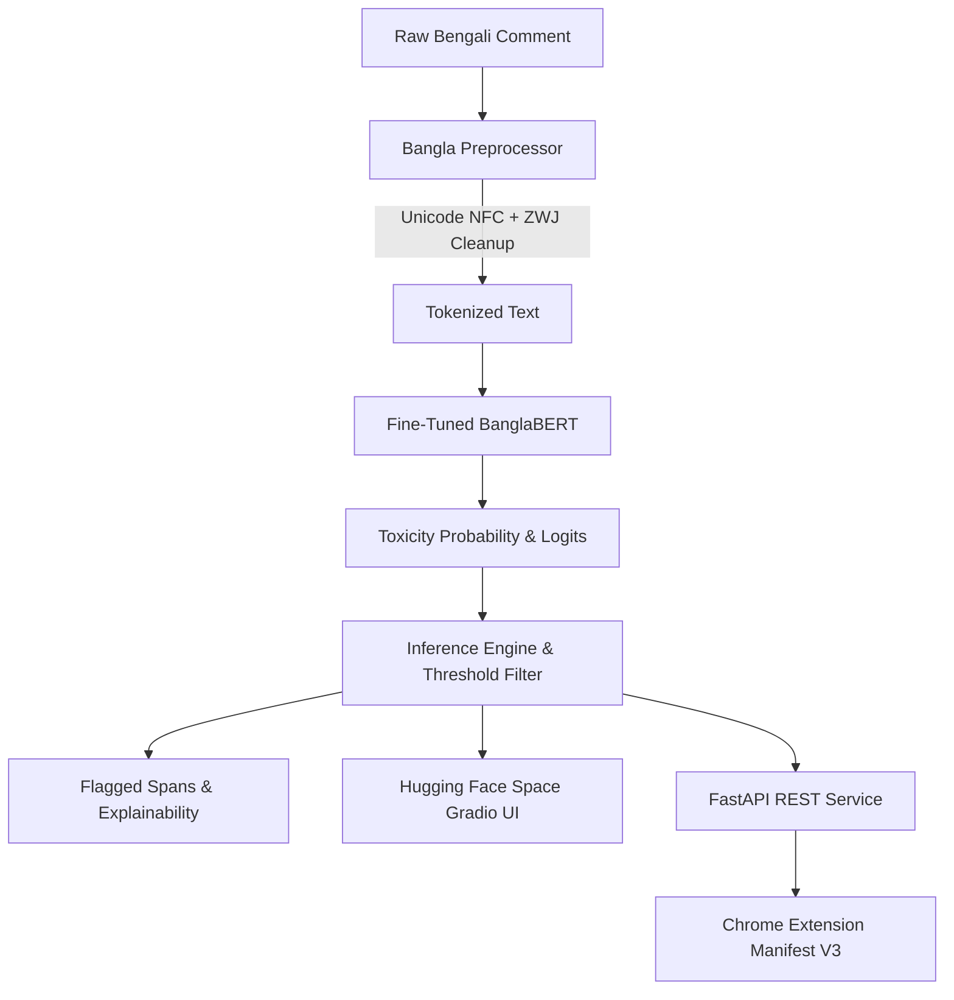

# 🛡️ Bangla Toxic and Harassment Comment Detector

[](https://github.com/ShaieraOishe/bangla-toxic-detector/actions)
[](https://huggingface.co/SS009/banglabert-toxic-detector)
[](https://www.python.org/downloads/)
[](https://opensource.org/licenses/MIT)
[](https://github.com/psf/black)

An end-to-end NLP moderation system designed to detect online harassment, cyberbullying, and toxic abuse in the Bengali language. Powered by fine-tuned **BanglaBERT** (`csebuetnlp/banglabert`), packaged with a **Hugging Face Spaces demo**, a **FastAPI backend**, and a **Chrome Extension (Manifest V3)** for live on-page safety checks.

---

## 📌 Problem & Motivation

- **Under-resourced Language:** While hate speech filters are mature in English, Bengali (spoken by over 230 million people) suffers from a severe lack of deployed, production-ready moderation tools.
- **Cyberbullying & Gender Harassment:** Social media in South Asia exhibits high rates of targeted cyber harassment against women, public figures, and marginalized communities.
- **Linguistic Complexities:** Bengali text on social media combines standard Bengali script, colloquial dialects, English loanwords, and zero-width joiners (`\u200D` / `\u200C`) which easily break off-the-shelf multilingual models.

---

## 💡 Solution Overview

This repository provides a complete engineering pipeline:
1. **Bengali Text Normalizer:** Cleans zero-width characters, handles punctuation, strips extraneous URLs/mentions, and applies Unicode NFC normalization.
2. **Fine-Tuned BanglaBERT:** Leverages the state-of-the-art ELECTRA-based Bengali foundation model with weighted cross-entropy loss to combat extreme class imbalances.
3. **Multi-Interface Deployment:**
   - **Hugging Face Space / Gradio UI:** For interactive public testing with confidence scores and highlighted abusive spans.
   - **FastAPI REST API:** High-throughput JSON endpoint for real-time applications.
   - **Chrome Extension (Manifest V3):** Alerts users when typing or reading abusive Bengali comments on platforms like Facebook, YouTube, and X.
4. **SQA & Test Rigor:** Automated test suite with Pytest and GitHub Actions CI.

---

## 🏗️ Architecture



---

## 🚀 Quickstart

### 1. Installation

```bash
git clone https://github.com/ShaieraOishe/bangla-toxic-detector.git
cd bangla-toxic-detector

# Create virtual environment
python3 -m venv venv
source venv/bin/activate  # On Windows: venv\Scripts\activate

# Install dependencies
pip install -r requirements.txt
```

### 2. Run the Hugging Face Spaces (Gradio) Demo

```bash
python app/app.py
```
Open [http://localhost:7860](http://localhost:7860) in your browser.

### 3. Run the FastAPI Service

```bash
uvicorn app.api:app --reload --port 8000
```
- API Docs: [http://localhost:8000/docs](http://localhost:8000/docs)
- Health check: [http://localhost:8000/health](http://localhost:8000/health)

Example prediction request:
```bash
curl -X POST "http://localhost:8000/predict" \
     -H "Content-Type: application/json" \
     -d '{"text": "আপনার পোস্টটি অনেক তথ্যবহুল ও চমৎকার ছিল!", "threshold": 0.5}'
```

---

## 🧩 Chrome Extension Installation

1. Open Google Chrome and go to `chrome://extensions/`.
2. Enable **Developer mode** (toggle in the top-right corner).
3. Click **Load unpacked** and select the `extension/` directory.
4. Pin the **Bangla SafeNet** icon to your browser bar.
5. Enter any Bengali comment into the popup or type in supported social media boxes.

---

## 🧪 Testing & Software Quality Assurance (SQA)

Automated testing covers edge cases, Unicode corner cases, confidence scores, and API status codes:

```bash
# Run full test suite
pytest tests/ -v

# Run code linter
flake8 src app tests
```

---

## 📊 Model Benchmark Results

Fine-tuned on **50,281 real Bengali social media comments** (40,224 train / 5,028 val / 5,029 holdout test):

| Metric | Score | Note |
| :--- | :---: | :--- |
| **Accuracy** | **90.91%** | Evaluated on 5,029 unseen holdout test samples |
| **Macro F1** | **90.91%** | Balanced performance across safe and toxic classes |
| **Macro Precision** | **90.95%** | Minimal false alarms on non-toxic constructive debates |
| **Macro Recall** | **91.00%** | Captures 91% of abusive, harassing, and bullying remarks |

---

## 📊 Model Card & Ethics

- **Base Model:** `csebuetnlp/banglabert` (ELECTRA architecture)
- **Primary Task:** Binary / Multi-category Bengali Sequence Classification
- **Dataset Sources:** Bengali Hate Speech & Cyberbullying datasets from Mendeley / Hugging Face.
- **Fairness & Limitations:**
  - Colloquial slang and satirical humor may occasionally produce false positives.
  - The model should be used as an assistive moderation tool, complemented by human review for high-stakes account moderation actions.

---

## 👩‍💻 Author

**Shaiera Sultana Oishe**  
*AI/ML & SQA Engineer *  
[GitHub Profile](https://github.com/) · [LinkedIn](https://linkedin.com/)
